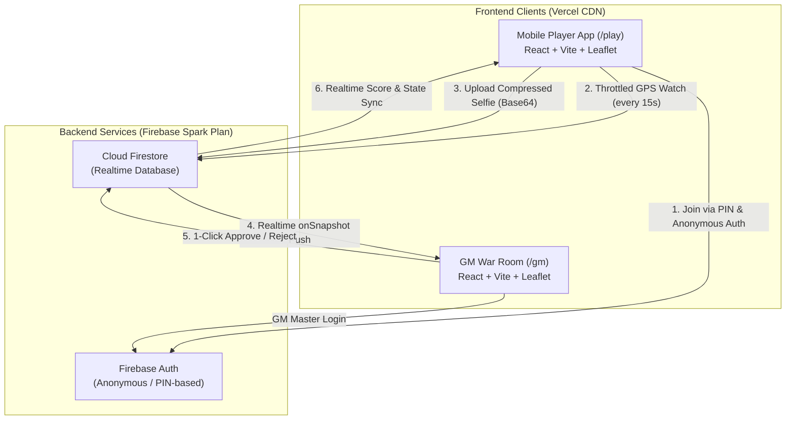

# System Architecture Document (SAD)
## Project: Melaka Heritage Photo Hunt (`heritage-hunt`)

---

## 1. System Overview & Data Flow



---

## 2. Tech Stack Rationale

| Tier | Technology | Technical Rationale |
| :--- | :--- | :--- |
| **Language** | **TypeScript 5.x** | End-to-end type safety for Game, Team, Clue, Submission, and Geo coordinate interfaces. |
| **Frontend Framework** | **React 19 + Vite 8** | Single Page Application (SPA) architecture with zero Server-Side Rendering (SSR) headaches for Leaflet. Sub-second build times. |
| **UI & Styling** | **Tailwind CSS v4** | Utility-first styling with high-contrast color badges for team identities and mobile-first touch optimization. |
| **Mapping Engine** | **Leaflet 1.9 + OpenStreetMap** | 100% open-source and free mapping. Supports custom SVG colored divIcon markers, zone polygons, and mobile touch pinch-zoom. |
| **Database & Realtime** | **Google Cloud Firestore** | Native `onSnapshot` real-time listeners for live review queues, leaderboard updates, and team radar locations. |
| **Authentication** | **Firebase Anonymous Auth** | Instant friction-free sign-in without passwords, emails, or OAuth redirects. |
| **Image Compression** | **`browser-image-compression`** | Compresses 10MB raw mobile photos to <= 150KB Base64 in the browser before network transmission. |
| **EXIF Parsing** | **`exifr`** | Client-side extraction of GPS Latitude & Longitude from GM clue photos for instant automated map pinning. |
| **Hosting & CI/CD** | **Vercel Hobby Tier** | Global CDN with Singapore edge nodes (`sin1`), automatic HTTPS (required for mobile GPS and camera APIs), and zero-configuration GitHub CI/CD. |

---

## 3. Firestore Data Schema & Collections Design

### Document Structure:

```text
📁 games (collection)
   └── 📄 {gameId}
         ├── name: string
         ├── status: "lobby" | "active" | "frozen" | "ended"
         ├── startTime: Timestamp | null
         ├── durationMinutes: number
         ├── passCode: string (GM password)
         ├── zones: Array<{ id: string, name: string, color: string, polygon: [number, number][] }>
         │
         ├── 📁 teams (sub-collection)
         │     └── 📄 {teamId}
         │           ├── name: string
         │           ├── pin: string (e.g. "4821")
         │           ├── color: string (e.g. "#EF4444")
         │           ├── score: number
         │           ├── completedClueIds: string[]
         │           ├── currentCoords: { lat: number, lng: number, updatedAt: Timestamp }
         │           └── lastActiveAt: Timestamp
         │
         ├── 📁 clues (sub-collection)
         │     └── 📄 {clueId}
         │           ├── title: string
         │           ├── zoneId: string
         │           ├── points: number
         │           ├── targetPhotoBase64: string (Compressed Base64 Data URL)
         │           ├── location: { lat: number, lng: number }
         │           ├── hint: string
         │           └── createdAt: Timestamp
         │
         └── 📁 submissions (sub-collection)
               └── 📄 {submissionId}
                     ├── teamId: string
                     ├── teamName: string
                     ├── teamColor: string
                     ├── clueId: string
                     ├── clueTitle: string
                     ├── selfieBase64: string (Compressed Base64 Data URL <= 150KB)
                     ├── status: "pending" | "approved" | "rejected"
                     ├── rejectionReason?: string
                     ├── awardedPoints: number
                     ├── submittedAt: Timestamp
                     └── reviewedAt: Timestamp | null
```

---

## 4. Image Storage Architecture: Base64 in Firestore

### Why Direct Base64 in Firestore?
1. **$0.00 Cost Guarantee:** Google Firebase requires the paid Blaze tier (credit card) to activate Cloud Storage buckets. Storing compressed Base64 strings directly in Firestore documents remains **100% free** under the Spark plan.
2. **Document Size Compliance:**
   * Maximum Firestore document limit: **1,048,576 bytes (1.0 MB)**.
   * Target compressed selfie size: **~100 KB – 150 KB** (1024×768 resolution, JPEG 65% quality).
   * Margin of safety: Well below the 1 MB document threshold.
3. **Atomic Consistency:** The team ID, timestamp, GPS metadata, and selfie image exist in a single Firestore document. No broken image links or dangling file pointers.
4. **Instant GM Queue:** When a submission arrives via `onSnapshot`, the GM queue receives both the metadata and the preview image instantly in one atomic network packet.

---

## 5. Map & Geolocation System

### A. Geolocation Polling & Throttling
```typescript
// Throttled Geolocation Hook Architecture
navigator.geolocation.watchPosition(
  (position) => {
    const now = Date.now();
    if (now - lastBroadcastTime > 15000) { // 15-second throttle
      updateTeamCoordinates(teamId, {
        lat: position.coords.latitude,
        lng: position.coords.longitude,
        updatedAt: new Date()
      });
      lastBroadcastTime = now;
    }
  },
  (error) => console.warn("GPS error:", error),
  { enableHighAccuracy: true, timeout: 10000, maximumAge: 10000 }
);
```

### B. Haversine Distance Calculation
Used to compute the physical distance between the player's live selfie location and the target clue coordinates:
$$d = 2R \cdot \arcsin\left(\sqrt{\sin^2\left(\frac{\Delta\phi}{2}\right) + \cos(\phi_1)\cos(\phi_2)\sin^2\left(\frac{\Delta\lambda}{2}\right)}\right)$$
This value is displayed in the GM review queue (e.g., *"Team was 14 meters away from target"*), helping the GM verify authenticity.
