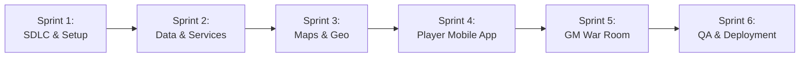

# SDLC Implementation Plan & Roadmap
## Project: Melaka Heritage Photo Hunt (`heritage-hunt`)

---

## 1. Overview & Phased Roadmap

This document outlines the phased sprints, work breakdown structure (WBS), task dependencies, and acceptance criteria for building the application.

---

## 2. Sprint Breakdown & Task Checklist

### Sprint 1: Environment Baseline & SDLC Documentation
- [x] **Task 1.1:** Setup Windows development toolchain (Node.js 24 LTS, npm 11, MinGit).
- [x] **Task 1.2:** Initialize Vite + React 19 + TypeScript SPA in `C:\Users\User\Projects\heritage-hunt`.
- [x] **Task 1.3:** Install core dependencies (`firebase`, `leaflet`, `react-leaflet`, `lucide-react`, `browser-image-compression`, `exifr`, `tailwindcss`, `qrcode.react`, `canvas-confetti`).
- [x] **Task 1.4:** Configure Tailwind CSS v4 and Leaflet dark-theme styling.
- [x] **Task 1.5:** Author SDLC documentation: `docs/PRD.md`, `docs/ARCHITECTURE.md`, `docs/IMPLEMENTATION_PLAN.md`, `docs/SECURITY_AND_DEPLOYMENT.md`.

---

### Sprint 2: Core Data Layer, Firebase Configuration & Image Processing
- [ ] **Task 2.1: TypeScript Interfaces (`src/types/index.ts`)**
  - Define `Game`, `Team`, `Clue`, `Submission`, `Zone`, `Coordinate`, and `GeoDistance` models.
  - *Acceptance Criteria:* Clean compile with strict null checks.
- [ ] **Task 2.2: Firebase & Hybrid Mock Adapter (`src/config/firebase.ts`)**
  - Initialize Firebase App, Firestore, and Auth.
  - Support automatic Mock State Adapter when running with demo keys so development and testing can proceed without network blocking.
  - *Acceptance Criteria:* Smooth switching between mock state and live Firestore.
- [ ] **Task 2.3: Image Compression & EXIF Parsing (`src/services/imageCompression.ts`)**
  - Implement `compressPhoto(file: File): Promise<string>` targeting <= 150 KB Base64.
  - Implement `extractExifGps(file: File): Promise<{ lat: number, lng: number } | null>`.
  - *Acceptance Criteria:* Standard 8MB mobile camera photo compresses to < 150 KB in under 1 second.
- [ ] **Task 2.4: Realtime Game Service (`src/services/gameService.ts`)**
  - Real-time `onSnapshot` listeners for Game State, Teams, Clues, and Submissions.
  - Submission creation, approval, and rejection methods.

---

### Sprint 3: Melaka Heritage Geography & Leaflet Map Engine
- [ ] **Task 3.1: Pre-configured Melaka Data (`src/data/melakaZones.ts`)**
  - Define geo-polygons for Jonker Street, Dutch Square / Stadhuys, A Famosa & St. Paul's Hill, and Jalan Tokong.
  - Pre-load sample clues with authentic Melaka coordinates and cropped landmark teasers.
  - Pre-configure high-contrast team palettes (Crimson, Cobalt, Emerald, Amber, Violet).
- [ ] **Task 3.2: Geolocation Tracking Hook (`src/hooks/useGeolocation.ts`)**
  - Implement `navigator.geolocation.watchPosition` with 15-second broadcast throttle.
  - Calculate Haversine distance from current position to target clue pin.
- [ ] **Task 3.3: Interactive Leaflet Map Component (`src/components/Map/HuntMap.tsx`)**
  - Leaflet map centered at Melaka `[2.1944, 102.2491]`.
  - Render zone polygons with transparent fills and colored borders.
  - Render clue pins with thumbnail popups.
  - Render team markers with pulsing radar circles in assigned team colors.

---

### Sprint 4: Mobile Player Experience (`/play`)
- [ ] **Task 4.1: Frictionless Team Join Screen (`src/components/Player/JoinTeamModal.tsx`)**
  - 4-digit PIN input and QR code parser.
  - Player nickname entry.
- [ ] **Task 4.2: Player Hunt Header & Navigation (`src/components/Player/PlayerHeader.tsx`)**
  - Display team badge, live score, and game countdown timer.
  - View toggles: [Interactive Map] / [Clues Cards] / [Leaderboard].
- [ ] **Task 4.3: Clue Card & Detail Modal (`src/components/Player/ClueCard.tsx`)**
  - Show cropped target photo, point value, zone badge, and hint toggle.
- [ ] **Task 4.4: Camera Selfie Capture & Instant Compression**
  - Direct camera shutter trigger (`<input type="file" accept="image/*" capture="environment">`).
  - Compression progress indicator.
  - Live submission status banner ("Pending GM Approval" ➔ "Approved +100 pts" with confetti).

---

### Sprint 5: GM War Room Dashboard (`/gm`)
- [ ] **Task 5.1: GM Master Authentication & Game Controls**
  - GM passcode login.
  - Timer controls: Start Game, Pause, Freeze Leaderboard, End Game.
- [ ] **Task 5.2: Live Verification Queue**
  - Side-by-side photo comparison: Target Clue vs Team Selfie.
  - Distance check (proximity between capture location and landmark).
  - 1-click buttons: `[Approve (+Pts)]`, `[Reject]`, `[Bonus (+20)]`.
- [ ] **Task 5.3: Clue & Zone Manager**
  - Bulk photo uploader with automatic EXIF GPS extraction.
  - Interactive pin drag-and-drop to adjust landmark locations.
- [ ] **Task 5.4: Team Generator & QR Code Display**
  - Team creation with color picker.
  - Printable / high-res on-screen QR codes and 4-digit PINs.
- [ ] **Task 5.5: Live Leaderboard**
  - Real-time team rankings with clue completion counts.
  - "Freeze" indicator banner.

---

### Sprint 6: End-to-End Testing, Quality Assurance & Deployment
- [ ] **Task 6.1: Cross-Browser & Mobile Viewport QA**
  - Verify layout on iOS Safari and Android Chrome viewport dimensions.
- [ ] **Task 6.2: Multi-Team Simulation Test**
  - Simulate 3 simultaneous teams submitting selfies and tracking GPS movements.
- [ ] **Task 6.3: Vercel SPA Deployment & GitHub Actions Guide**
  - Verify production build (`npm run build`).
  - Step-by-step GitHub push and Vercel import instructions.
